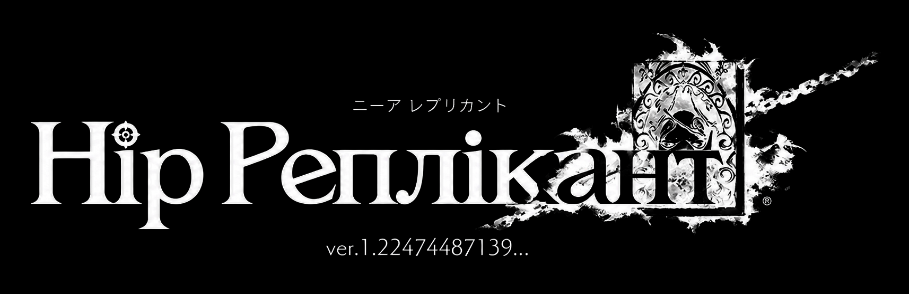
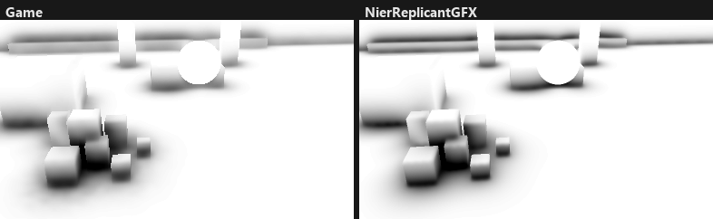
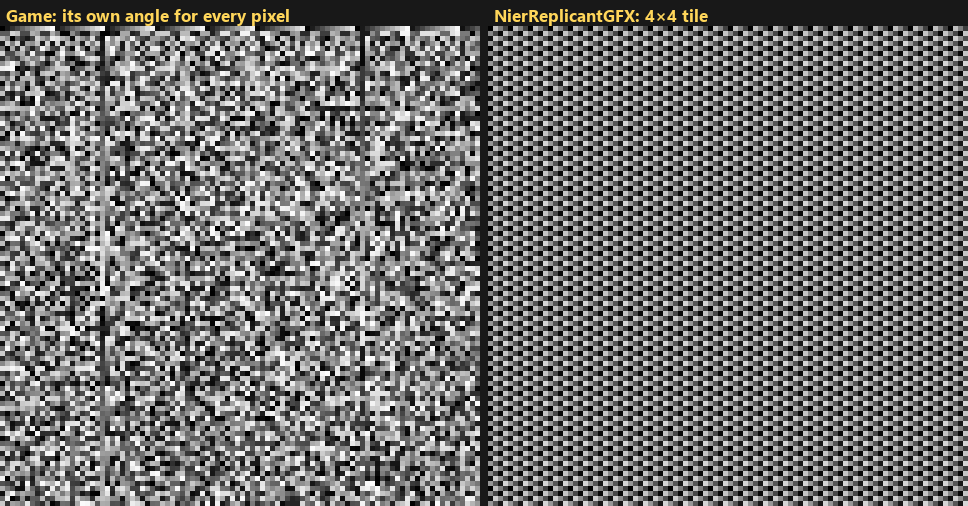
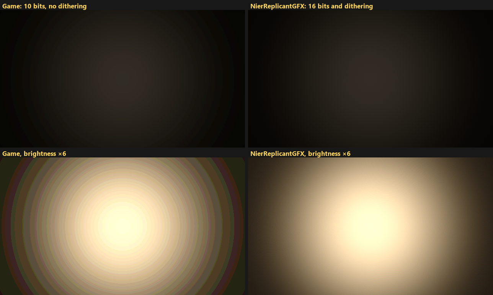
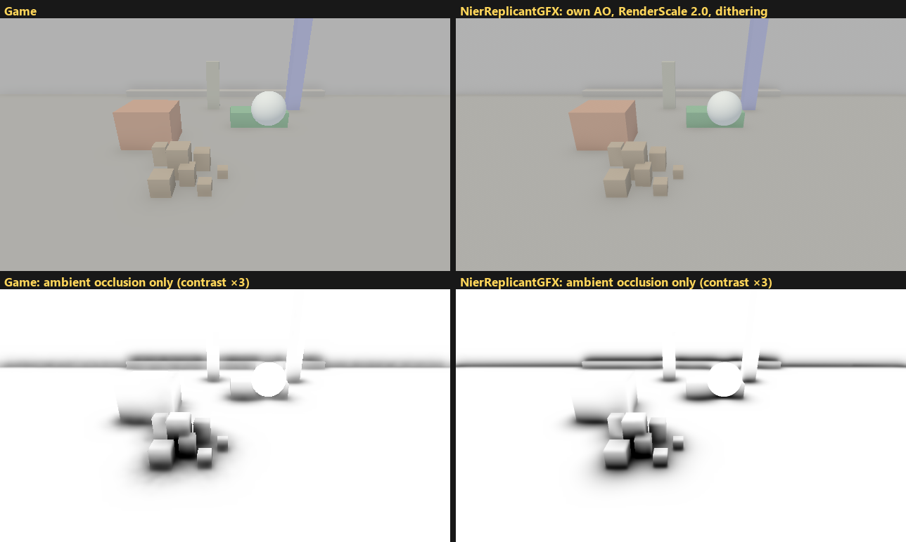

<p align="center">
  <picture>
    <source media="(prefers-color-scheme: dark)" srcset="docs/logo.png">
    
  </picture>
</p>

<p align="center"><a href="README.md">Українська</a> · <b>English</b></p>

# NieR Replicant ver.1.22474487139: text limits and graphics fixes

Two plugins for the Steam version of NieR Replicant ver.1.22474487139:

- **NierReplicantUA** lifts the text length limits of the game that the Ukrainian translation runs into;
- **NierReplicantGFX** fixes graphics and works with any game language.

Both change the game's code in memory at startup and leave the game files alone. Before each change a
plugin checks that the code at that place matches the Steam version. If it does not (another game
version or another mod), the change is skipped and the reason goes to the log next to the DLL.

Author: Swiftlyx. Code license: [MIT](LICENSE); see Redistribution for the translation files.

## NierReplicantUA

Ukrainian text is longer than English, and several internal buffers of the game are too small for it.
The plugin:

- enlarges the interface string pool from 256 KB to 1 MB (otherwise parts of the menus stay empty and
  the game crashes on weapon stories);
- shows the full item name in "Obtained ..." instead of the first ~13 letters;
- keeps speaker names up to 63 bytes;
- shows fishing records in centimetres and kilograms;
- puts the name before the words in Word Edit lines (magic and weapon lists), the order the
  Ukrainian phrases need;
- reads the archive index from `data\info_uk.arc`, so the original `data\info.arc` stays as it is.

The Word Edit order is set in `NierReplicantUA.ini` next to the translation DLL: `NameFirst = 1` (the
default) puts the name first, `NameFirst = 0` keeps the game's order. Restart the game after a change.

The game keeps this order in two places. The line in the magic and weapon lists is built by code from
word A, word B and the name in the order of a per-language table inside the exe; no data file holds it,
so the plugin rewrites the English row (the slot the translation uses) to name, A, B, as the game already
does for French, Italian and Spanish. The word set screen draws its three columns at the places given by
its layout (`white_book_word_separate_word` in the game archives), which is data, so the columns are
swapped in `ua.arc` with the other interface changes of the translation. That screen takes the meaning of
each column (selection, word lists, name colour) from a copy of the same table; changing the copy leaves
the columns in place and opens empty word lists, so the plugin leaves it alone. As a result,
`NameFirst = 0` restores the order only in the magic and weapon lists; the word set screen keeps the name
on the left. The translated text is written for the name-first order.

The translation itself (text, font, textures) is in `ua.arc`, which comes with the plugin in the
translation archives. It is an AI translation: the text was translated by Claude Opus 5.5 (Extra high)
by Anthropic; terminology, style, corrections and in-game testing by Swiftlyx.

## NierReplicantGFX

- **Ambient occlusion.** The plugin's own shader replaces the game's. The strength is the same, but
  there is no pattern moving with the camera, and shadows fade much less near the screen edges and
  around characters. The pattern only shows in motion and where there is a lot of shading.
- **No feedback blur.** The game blends each frame with the previous ones, most visibly when rolling.
- **No rings in glows.** The game keeps the frame in 10-bit buffers; the plugin makes them 16-bit and
  dithers the output.
- **Supersampling (SSAA).** The frame is rendered larger than the screen and scaled down. Off by
  default, see `RenderScale`. Works together with
  [NierReplicantFix](https://codeberg.org/Lyall/NierReplicantFix), including its support for any aspect
  ratio.

Settings are in `NierReplicantGFX.ini`, each one described in the file. It lies next to the graphics DLL:
in the game folder (Standalone), in `LunarTear\mods\NierReplicantGFX` (Lunar Tear) or next to
`NierReplicantGFX.asi` (ASI). Restart the game after a change.

### How it looks

A test scene run through the game's real ambient occlusion shader and through the plugin's: not game
screenshots, but an illustration of what the plugin changes. Left, the game; right, NierReplicantGFX.



The camera turns as with the right stick. The blotches in the game's shading stay in place on the screen
while the scene moves under them, so a pattern seems to follow the camera. It only shows in motion and
where there is a lot of shading, so screenshots show the difference less than the game does.



Where the pattern comes from: the game turns the directions it searches for occluders by its own angle for
every pixel. This noise is too coarse for the game's blur. The plugin uses a 4×4 pixel tile that the blur
removes.



A dim glow in the dark: at 10 bits there are rings near black; at 16 bits with dithering the gradient is
smooth. The bottom row is the same with brightness ×6.



The whole frame (top) and ambient occlusion only with extra contrast (bottom); right, the plugin's own
ambient occlusion, `RenderScale = 2.0` and dithering.

## Installation

Ready-to-use files are on the [Releases](https://github.com/Swiftlyx/nier-replicant-ua-gfx/releases/latest)
page, three archives per plugin, one per installation method (also on Nexus Mods: [translation](https://www.nexusmods.com/games/nierreplicant/mods/131),
[graphics](https://www.nexusmods.com/nierreplicant/mods/130); new versions appear here first). The simplest and fastest is Standalone: download
the archive and drag its contents into the game folder. Which one to pick:

- **Standalone**, if you only want these mods: no third-party tools, and the plugin loads first;
- **Lunar Tear**, if you already install other mods with it: it merges the archives of all mods;
- **ASI**, if you already use Ultimate ASI Loader or Special K.

Use one method per plugin. The loaders themselves can be combined: Special K loads Lunar Tear or `.asi`
files as plug-ins, and Ultimate ASI Loader works next to Lunar Tear as long as their file names differ.
Extract the archives into the game folder, the one with
`NieR Replicant ver.1.22474487139.exe` (in Steam: Manage → Browse local files; usually
`C:\Program Files (x86)\Steam\steamapps\common\NieR Replicant ver.1.22474487139`).

- **Standalone:** extract `*-Standalone.zip` into the game folder; the game loads these DLLs by itself. On
  Steam Deck or Proton add `WINEDLLOVERRIDES="dinput8,xinput9_1_0=n,b" %command%` to the launch options.

  ```
  NieR Replicant ver.1.22474487139\
  ├─ NieR Replicant ver.1.22474487139.exe
  ├─ dinput8.dll                  translation
  ├─ NierReplicantUA.ini          translation settings
  ├─ xinput9_1_0.dll              graphics
  ├─ NierReplicantGFX.ini         graphics settings
  └─ data\
     ├─ ua.arc                    translation
     └─ info_uk.arc               translation
  ```

- **Lunar Tear:** install [Lunar Tear](https://www.nexusmods.com/nierreplicant/mods/87), then extract
  `*-LunarTear.zip` into the game folder; the archives already contain `LunarTear\mods\…`, so missing
  folders are created (if they are not, create them and put the archives' files there). Lunar Tear stands in for three libraries, so its file may be named `dxgi.dll` (as its
  author suggests), `d3d11.dll` or `dinput8.dll`, whichever no other mod uses. It can also be loaded
  through Special K as a plug-in with Load Order Early, under any file name and in any folder; the mods
  stay in `LunarTear\mods`. If `LunarTear\lunartear.log` says "VFS hook missed", it loaded too late and
  archive mods are not applied.

  ```
  NieR Replicant ver.1.22474487139\
  ├─ dxgi.dll                     Lunar Tear itself (or d3d11.dll, dinput8.dll; or loaded by Special K)
  └─ LunarTear\
     └─ mods\
        ├─ UkrainianTranslation\    NierReplicantUA.dll, NierReplicantUA.ini, ua.arc, info.arc, manifest.json
        └─ NierReplicantGFX\        NierReplicantGFX.dll, NierReplicantGFX.ini, manifest.json
  ```

- **ASI:** extract `*-ASI.zip` into the game folder. The game is 64-bit DirectX 11, so use x64 loaders,
  named after a library the game loads at startup, such as `winmm.dll`, `d3d11.dll`, `dxgi.dll` or
  `dinput8.dll`. Any such name works if the loader supports it and no other mod uses it (`dinput8.dll` and
  `xinput9_1_0.dll` are the Standalone files, `dxgi.dll` is Lunar Tear). The `.asi` files may move to a
  `scripts` or `plugins` subfolder together with their `.ini` files; `ua.arc` and `info_uk.arc` stay in
  the game's `data` folder.

  ```
  NieR Replicant ver.1.22474487139\
  ├─ winmm.dll                    Ultimate ASI Loader (or another free name)
  ├─ NierReplicantUA.asi          translation
  ├─ NierReplicantUA.ini          translation settings, always next to NierReplicantUA.asi
  ├─ NierReplicantGFX.asi         graphics
  ├─ NierReplicantGFX.ini         graphics settings, always next to NierReplicantGFX.asi
  └─ data\
     ├─ ua.arc                    translation, always in the game's data
     └─ info_uk.arc               translation, always in the game's data
  ```

  - [Ultimate ASI Loader](https://github.com/ThirteenAG/Ultimate-ASI-Loader): put the DLL from
    `Ultimate-ASI-Loader_x64.zip` into the game folder, for example as `winmm.dll` or `d3d11.dll`;
  - [Special K](https://www.special-k.info/) ([GitHub](https://github.com/SpecialKO/SpecialK)): in the
    Special K menu (Ctrl + Shift + Backspace) open Plug-Ins → Third-Party → Add Plug-In, add each `.asi`
    and set its Load Order to Early; it takes effect on the next start. Or add an
    `[Import.NierReplicantUA]` section (and the same for GFX) to `SpecialK.ini` of the game profile or to
    the ini of a local install, with `Architecture=x64`, `Role=ThirdParty`, `When=Early` and the full
    path in `Filename`. Early loading is required for the translation. A local install may look like this
    (with global injection there is no Special K DLL in the game folder; its settings are in
    `Documents\My Mods\SpecialK\Profiles\…`):

    ```
    NieR Replicant ver.1.22474487139\
    ├─ d3d11.dll                    Special K (SpecialK64.dll under a free name: d3d11.dll or dxgi.dll)
    ├─ d3d11.ini                    Special K settings, named like its DLL
    ├─ NierReplicantUA.asi
    ├─ NierReplicantUA.ini          next to NierReplicantUA.asi
    ├─ NierReplicantGFX.asi
    ├─ NierReplicantGFX.ini         next to NierReplicantGFX.asi
    └─ data\
       ├─ ua.arc                    always in the game's data
       └─ info_uk.arc               always in the game's data
    ```

For the translation, choose English as the text language in the game settings: the translation takes
the English slot. To remove the mods, delete the extracted files; the game files are not changed.

## If something is wrong

Each plugin writes a log next to its DLL or `.asi` (`NierReplicantUA.log`, `NierReplicantGFX.log`). No log
means the plugin was not loaded: check the file layout above.

- **The text is in English.** Choose English as the text language. With Standalone or ASI the
  translation log must contain `index    mount "" … info_uk.arc`; with Lunar Tear, `lunartear.log` must not
  say "VFS hook missed".
- **Parts of the menus are empty, the game crashes on weapon stories.** The log says `pool     skipped`:
  the plugin loaded after the game read its text. Set Load Order to Early (in Special K) or use Standalone.
- **Other archive mods stopped working.** Standalone and ASI give the game their own archive index, so
  mods that replace game files through Lunar Tear archives do not combine with them; install everything
  through Lunar Tear.
- **No log, the plugin is not loaded.** Windows may block files downloaded from the internet. Open the
  properties of the DLL or `.asi` (and of Lunar Tear, Special K or the ASI loader, if you use them); if the
  General tab says the file came from another computer, tick Unblock and press OK. Unblocking the archive
  before extracting it unblocks every file inside.
- **An antivirus blocks or removes a DLL.** The plugins, Lunar Tear, Special K and ASI loaders are
  libraries (DLLs) that the game loads into itself, so antiviruses sometimes flag them by mistake. Add the
  game folder to the exceptions and restore the files from quarantine; get everything from official pages
  only.
- **The game was updated or Steam verified the files.** Verification leaves these mods in place, since
  they replace no game files. If an update changes the game code, the plugins change nothing and log
  `skipped`; a new version of the mods is needed then.
- **The game runs slowly with NierReplicantGFX.** Supersampling is the heaviest: use `RenderScale = 1.0`
  (the default) or a lower value such as 1.5.
- **The ambient occlusion looks too dark or too light.** Adjust `Strength` in `NierReplicantGFX.ini` to your
  taste: higher is darker, lower is lighter. If you prefer the game's original shading, set `Shader = 0`.

## Redistribution

The plugin code is MIT licensed: copies must keep `Copyright (c) 2026 Swiftlyx` and the license text.
The translation files in the releases (`ua.arc`, `info.arc`, `info_uk.arc`) are not covered by the MIT
license. They may be redistributed, including on other sites and in modpacks, only with credit to
Swiftlyx and a link to this repository or the mod page.

## Building

`build.bat` builds both plugins with MSVC Build Tools 2022 (x64). `build.bat test [game exe] [libtp folder]`
also runs the offline tests, which need Python 3.
